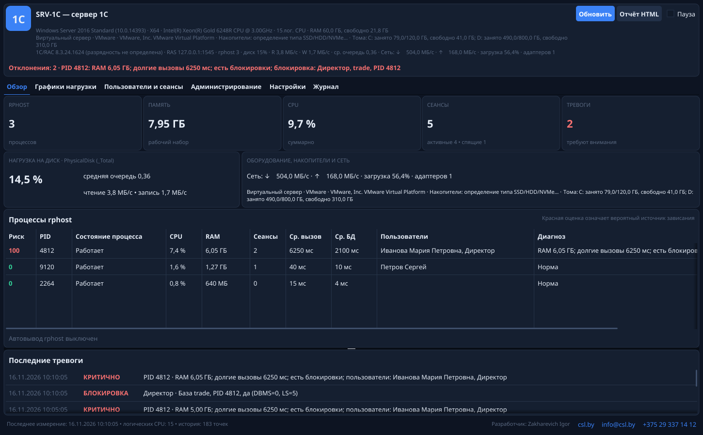
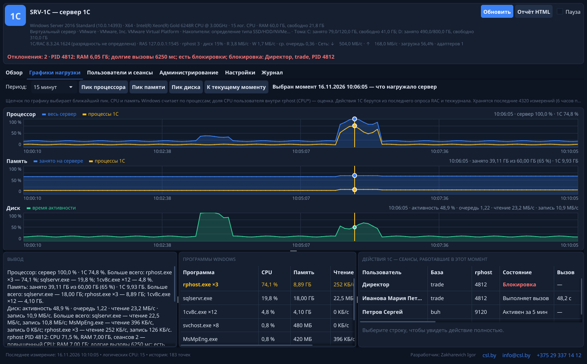

# 1C Server Monitor — версия на Go + Fyne

Перенос монитора сервера «1С:Предприятие» (каталог `OneCMonitor`, C# + Avalonia) на Go с интерфейсом
[Fyne](https://fyne.io) v2.8.2. Один исполняемый файл без .NET и без установки.



Снимок получен программным рендерером Fyne на имитации кластера (тест `internal/ui`), а не на живом сервере.

## Что умеет

То же, что версия на .NET, и вкладка графиков:

- «Обзор»: процессы `rphost` (CPU, RAM, сеансы, средние вызовы, оценка риска и диагноз), нагрузка на диск,
  оборудование и сеть, последние тревоги;
- «Графики нагрузки»: процессор, память и диск во времени — весь сервер и отдельно процессы 1С. Щелчок по пику
  показывает, что работало в этот момент: программы Windows (CPU, память, ввод-вывод), процессы `rphost`
  и сеансы 1С с выполнявшимися действиями. Этой вкладки в версии на .NET нет;
- «Пользователи и сеансы»: 23 столбца по каждому сеансу из RAC и техжурнала, поиск, подробности выбранной строки;
- «Администрирование»: завершение сеансов, фоновые задания, плавный вывод `rphost`, перезапуск служб,
  принудительное завершение `rphost` — с контрольными фразами `ПОДТВЕРЖДАЮ` и `УБИТЬ RPHOST`;
- «Настройки»: подключение к RAS, суточный отчёт, автовывод `rphost`, интервалы опроса, пороги тревог;
- «Журнал», HTML-отчёт на рабочий стол, суточный отчёт, история в CSV.

Настройки и история лежат там же, где у версии на .NET — `%LOCALAPPDATA%\1CServerMonitor`, формат
`settings.json` общий. Рядом пишутся `interface.log` (сообщения интерфейса) и `crash.log` (аварийное завершение).

### Графики нагрузки



- Измерение делается на каждом такте мониторинга (по умолчанию раз в 5 секунд). Хранятся последние
  4320 измерений — 6 часов при таком шаге; история лежит в памяти и при закрытии программы пропадает.
- Процессор и память Windows учитывает по процессам. Процессы с одинаковым именем сложены
  (`rphost.exe ×3`, `1cv8c.exe ×12`). Чтение и запись — это весь ввод-вывод процесса: диск, сеть и каналы вместе.
- Внутри `rphost` Windows не разделяет нагрузку по пользователям: столбец «CPU*» — оценка, как и на вкладке сеансов.
- Действия 1С берутся из последнего опроса RAC и техжурнала, то есть могут быть старше измерения на
  интервал опроса RAC (по умолчанию 15 секунд). Если RAC не отвечал, в выводе это сказано.
- Короткий всплеск между двумя измерениями виден как средняя нагрузка за интервал.

## Требования

- Windows 10 / Windows Server 2016 или новее (ограничение Go 1.27, которым собраны файлы).
- **OpenGL 2.1.** Fyne рисует окно через OpenGL и программной отрисовки не имеет. В сеансе RDP и на
  виртуальной машине без драйвера видеокарты Windows даёт только OpenGL 1.1 — тогда программа покажет
  окно с объяснением и завершится. Варианты решения перечислены в этом сообщении: `opengl32.dll` из
  Mesa3D рядом с программой, аппаратная графика в сеансах RDP через групповую политику либо версия на .NET.
- Для администрирования — запуск от имени администратора.

## Сборка

Нужны Go 1.23+ и компилятор C для Windows (Fyne использует cgo).

В Windows с MinGW-w64 (`gcc` в `PATH`):

```
go build -trimpath -ldflags "-H windowsgui -s -w" -o 1C-Server-Monitor-Go.exe .
```

Кросс-компиляция из Linux или macOS через `zig cc` — так собраны файлы в каталогах
`OneCServerMonitorGo-win-x64` и `OneCServerMonitorGo-win-x86`:

```
./build.sh        # обе разрядности
./build.sh 64     # только x64
```

Значок и манифест уже лежат в `rsrc_windows_*.syso`; пересоздать их из `winres/app.manifest` и
`OneCMonitor/Assets/app.ico`: `REBUILD_RESOURCES=1 ./build.sh` (нужен `github.com/akavel/rsrc`).

## Проверка

```
go test -race ./internal/...
```

- `internal/monitor` — логика без интерфейса: разбор вывода RAC и техжурнала, цикл опроса, тревоги,
  административные операции, отчёты, расчёт нагрузки программ для графиков. Тесты работают на имитации
  системы и `rac.exe`.
- `internal/ui` — окно Fyne. Тест строит его без экрана и проверяет на данных имитации;
  `SCREENSHOT_DIR=каталог go test ./internal/ui` сохраняет снимки всех вкладок.
- `internal/monitor/system_windows.go` — вызовы WinAPI (память, счётчики PDH дисков, сетевые счётчики, список процессов
  и их счётчики, время процессоров, реестр).
  Этот файл тестами не покрыт: проверяется только компиляция под `windows/amd64` и `windows/386`.
